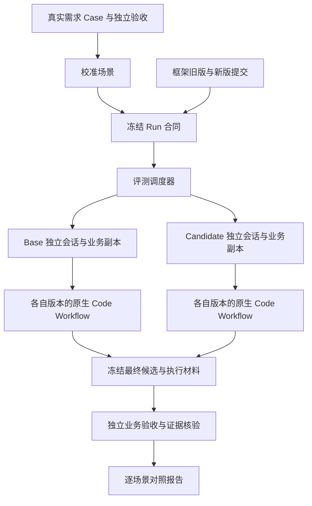

# 框架版本真实任务评测方案

状态：设计提案，尚未实现。日期：2026-10-31。

适用项目：`autobiz_kanban`。参考源码：HelixHarness `44ffc536f73d8af525b4795ad10384c516898576`。

本文中的模块、字段和适配接口均为建议设计，不代表平台已有 API。现有可复用能力在文中单独说明。

## 1. 要解决的问题

让同一批真实业务需求分别经过旧版、新版框架执行，判断框架修改是否改善了交付结果，以及为此付出了多少成本。

一次实验只改变框架版本。业务起点、可见需求、初始知识、模型设置、环境、权限、资源预算与验收规则保持一致。若实验同时修改模型或环境，应另建实验并明确变量，不能把差异全部归因于框架。

需要同时回答：

1. 新功能是否实现，已有行为是否回归？
2. 工作流是否按其声明的范围完成，证据是否对应真实代码和执行？
3. 耗时、Token、返工及人工介入是否改善？
4. 结果是否稳定，失败来自框架、业务实现、环境还是评测材料？

现有单元测试、契约测试继续承担快速回归检查；本方案增加真实 Agent 执行回放，两者互补。

## 2. HelixHarness 是怎样实现的

其主链路可概括为：业务场景发布与校准 → 冻结实验合同 → 两侧独立执行 → 确定性验收 → 语义评价与资源汇总 → 对照报告。

| 环节 | 源码中的做法 | 对本项目的借鉴 |
| --- | --- | --- |
| 场景 | Case 保存需求、仓库起止提交、验收和澄清规则；场景与框架执行命令分离 | 一个 Case 可以长期评测多个框架版本 |
| 校准 | 在业务起点与已知解法上实际执行检查，确认新增行为 FAIL→PASS、既有行为 PASS→PASS | 先证明题目和验收有效，再测 Agent |
| 冻结 | Run 固定框架提交、执行策略、文档摘要、模型、预算及评分合同 | 分支后续移动不能改变已创建实验 |
| 执行 | 独立 Worker 使用版本快照、隔离配置和业务工作区运行原生流程 | 执行器必须覆盖真实工具与流程 |
| 交互 | 从冻结的澄清规则提供事实；材料无法回答的业务问题使 Case 无效 | 避免人工在两侧提供不同帮助 |
| 判定 | 业务检查先行；结果评价与工作流文档评价分开 | 产物齐全、模型自称完成均不能证明业务正确 |
| 成本 | 分开保存可归属业务成本、所有尝试实际成本及完整性 | 失败和重试的消耗不能消失 |

对应源码：[概念](https://github.com/didi/helixharness/blob/44ffc536f73d8af525b4795ad10384c516898576/helixharness-platform/bench/docs/concepts.md)、[校准](https://github.com/didi/helixharness/blob/44ffc536f73d8af525b4795ad10384c516898576/helixharness-platform/bench/scenario_calibration.py)、[冻结合同](https://github.com/didi/helixharness/blob/44ffc536f73d8af525b4795ad10384c516898576/helixharness-platform/bench/evaluation_contracts.py)、[执行与澄清](https://github.com/didi/helixharness/blob/44ffc536f73d8af525b4795ad10384c516898576/helixharness-platform/bench/scenario_codex.py)、[资源核算](https://github.com/didi/helixharness/blob/44ffc536f73d8af525b4795ad10384c516898576/helixharness-platform/bench/resource_accounting.py)。

其默认综合分权重为结果 60%、工作流 20%、效率 20%，并有具体回归容忍策略。本项目首版采用分项结果和零新增已确认回归，不直接沿用其权重、阈值或整个平台。

## 3. 首版范围：从冻结 Plan 到可验证集成候选

建议先完成 `CODE_EXECUTION` 评测：给定同一份已确认需求、规格、设计及 Plan，让两个版本运行真实 Code Workflow，比较实现、Review、UTest、集成和最终验证。

该范围适合评测：工程事实复用、任务上下文、执行门禁、并行批次、修复、恢复和 Merge Train 的修改。它不能证明 Specs、Design、Plan 的生成质量有所改善。

后续增加 `DEV_LIFECYCLE`：仅给需求与业务起点，由各版本自行生成 Specs、Design、Plan，再执行 Code。两种范围分别报告，不能混算。主要修改上游技能的候选版本，应直接进入生命周期评测。

首版执行终点定义为：固定 Workflow 已返回最终交付入口，集成候选、各仓库 SHA 和最终证据报告均可收集。随后由独立评测器判定是否成功。

终点不要求真实业务分支合并、CI/CD 或 Ops 归档。现有 `review_integration_and_confirm_promotion` 适合作为候选收集入口；它可能带失败报告返回，因此到达该入口本身不等于通过。

## 4. 架构与职责



评测调度器拥有实验、重复执行、预算与结果记录；现有 Runtime 继续拥有 Batch DAG、lease、任务状态、Worktree、Review、UTest、修复及集成。

评测端不另写一套 Batch 调度器，也不手改 Runtime 的状态来制造终态。

需要区分标识：`evaluationRunId` 是实验，`trialId` 是某次独立重复，`attemptId` 是该重复中的执行尝试，`runtimeRunId` 是插件自己的 scheduler run。日志必须能关联这些标识。

## 5. Case：一道题需要哪些材料

从已完成且可复现的历史需求提取。业务仓库的需求前提交称为 `businessBaseCommit`，已知实现提交称为 `businessSolutionCommit`；它们与框架的 Base/Candidate 是两组不同概念。

一个 Case 包含：

| 材料 | 内容 | 执行 Agent 是否可见 |
| --- | --- | --- |
| 需求 | 当时可以获得的目标、范围、边界与验收标准 | 是 |
| 业务起点 | 一个或多个仓库的需求前代码 | 是 |
| 初始上下文 | 已确认规格、设计、Plan、必要知识和设计素材 | 按评测范围提供 |
| 澄清规则 | 允许补充的业务事实和流程选择 | 由固定交互控制器提供 |
| 参考解法 | 用于校准检查的历史实现 | 否 |
| 独立验收 | 新增行为、回归行为及必要的结果检查 | 隐藏检查仅评测端可见 |
| 运行环境 | 工具链、依赖、服务、数据种子与隔离要求 | 只提供执行所需部分 |
| 故障计划 | 恢复专项中的中断位置和次数 | 评测控制器持有 |

建议的逻辑结构如下，字段为草案：

```json
{
  "schemaVersion": "autobiz.eval.case.v1",
  "caseId": "backend-status-filter",
  "scope": "CODE_EXECUTION",
  "repositories": [
    {
      "repositoryId": "sample-service",
      "mountPath": "service",
      "businessBaseCommit": "<40位业务起点SHA>",
      "businessSolutionCommit": "<40位已知解法SHA>"
    }
  ],
  "initialRequest": "initial-request.md",
  "initialArtifacts": "initial-artifacts/",
  "runtimeProfile": "sample-service-test-env-v1",
  "acceptance": "acceptance.json",
  "clarificationPolicy": "clarification.json",
  "expectedTerminal": "integration_candidate_report_ready"
}
```

`repositoryId` 是稳定身份；本机仓库路径放在运行配置中。`codeWorkspaces` 等绝对路径在创建执行副本时通过适配器绑定，记录模板摘要和绑定后摘要；两侧逻辑输入相同，不要求绝对路径字节相同。

首版选择能直接兼容两个框架版本的产物格式。格式不兼容时，需冻结明确的输入适配器，或改用生命周期评测；不能让模型临场修补评测输入。

### 示例：列表增加状态筛选

这是用于说明结构的示例业务，并非已选定的真实 Case。

- 需求：列表支持按状态筛选，未传状态时保持原行为，非法状态返回约定错误。
- 新增行为检查：指定状态只返回匹配数据、筛选后的分页与总数正确、非法值行为符合约定。
- 回归检查：默认列表、原有排序及权限隔离保持原行为。
- 初始产物：冻结需求与 Plan，不向 Agent 提供历史实现或完整验收补丁。

检查验证可观察行为，允许不同的正确实现，不要求与历史 diff 相同。

### 澄清规则

普通仓库事实由 Agent 自行查证。业务问题只使用 Case 中已冻结的事实；无法回答时标记 `CASE_INVALID`，补充材料并重新校准后形成新版本。不得一侧现场请教业务人员，另一侧自行猜测。

Code Workflow 启动前所需的任务卡、仓库映射及流程选择应提前准备完整。首版不把人工响应速度纳入模型执行效率。

## 6. 校准：先证明验收有效

每个 Case 进入正式比较前，在独立评测环境运行：

| 检查类型 | 业务起点 | 已知解法 | 含义 |
| --- | --- | --- | --- |
| F2P：新增行为 | 预期行为断言失败 | 通过 | 检查能区分功能是否实现 |
| P2P：回归保护 | 通过 | 通过 | 检查代表必须保留的旧行为 |
| 解法附加检查 | 按声明处理 | 通过 | 补充边界和结果约束 |

F2P 的失败必须由目标行为缺失引起；依赖下载失败、服务不可用、测试未执行或命令超时不算有效的 FAIL。

校准结果绑定 Case 内容摘要、业务提交、验收实现、环境和数据种子摘要。上述输入变化则重新校准。新版本保留旧版本及其历史实验，不覆盖。

故障恢复等工作流专项另有确定性检查和基线演练，不强行将基础设施故障包装成业务 F2P。业务验收和恢复专项指标分别展示。

## 7. 冻结实验：控制比较变量

每次创建 Run 固定以下内容：

| 类别 | 需要冻结的内容 |
| --- | --- |
| 框架 | 两侧精确 commit、插件目录、技能/Agent/Hook/Workflow 资源摘要 |
| Case | Case 版本、业务提交、需求、初始产物、知识、验收、澄清与故障计划 |
| 执行平台 | 客户端/服务版本、启动配置、实际加载的插件路径、工具能力及适配器版本 |
| 模型 | 主 Agent 与各子角色的模型标识、可用推理参数、API 配置身份 |
| 环境 | OS/镜像、工具链、依赖锁定信息、服务版本、端口映射、数据种子 |
| 预算 | 总时限、Token/工具调用限制、内部并发、恢复与重试规则 |
| 评测器 | 独立验收实现、证据校验器、报告算法、可选 Judge 的版本 |
| 实验设计 | 场景集合、重复次数、执行顺序、主指标、回归和采纳规则 |

凭据仅由执行环境提供，合同保存配置身份，不保存密钥。模型服务无法固定后端版本时记录这一限制及运行时间，避免声称完全可重复。

默认每个独立重复使用全新 Feature 状态、工程事实缓存、会话历史与环境数据。两侧从相同只读依赖缓存快照起步，写入层各自隔离。若评测热缓存收益，单独定义预热步骤并冻结。

一个 trial 内的多个 Batch 可按现有机制共享工程事实；不得跨 trial 或在两侧之间共享 Agent 生成的经验。

## 8. 执行适配：本项目最先需要验证的环节

### 已有能力

- `hooks/workflow_launcher.py` 能校验 Plan、物化固定脚本并返回完整 `workflowArgs`。
- `workflows/code-batched-execution.workflow.js` 承担真实批次执行。
- 原生 Git Worktree 和隔离集成分支承载候选成果。
- 最终证据汇总和合入报告能提供候选 SHA、验证状态与证据摘要。

### 尚需平台确认的能力

现有固定脚本需要平台的顶层 Workflow 工具及其运行时。普通 `node`、Python 或其他 Agent CLI 不能自动提供等价能力。

第一阶段需验证宿主是否能：

1. 创建隔离会话，并为该会话绑定指定插件快照、Hook 与 Agent 定义。
2. 设置正确的挂载工作区，由主 Agent 原样调用 launcher 返回的脚本和参数。
3. 返回会话/Workflow 状态、工具事件、子 Agent 标识及资源用量。
4. 支持受控中断、恢复、取消，并确认子进程和子 Agent 的停止情况。

建议的评测适配接口为 `startSession`、`observe`、`interrupt`、`resume`、`cancel`、`collectResult`。这些名称表达所需能力，不是已确认的平台 API。

若平台暂时无法按会话绑定版本，可先在两个独立宿主配置环境中做受控的人工启动试验，冻结输入后由相同评测器验收，并明确标注人工动作。该方式用于验证纵向链路；全自动版本比较仍需补齐宿主接入。

Mock 适配器只验证评测调度和报表，不能产出真实 Agent 收益结论。

### 每次独立执行

1. 从冻结业务起点导出文件，在临时目录初始化全新 Git 仓库和 `codex/eval-...` 分支，避免业务解法通过后续 Git 历史泄露。必要的 LFS、子模块及外部素材应作为显式资产准备并校验摘要。
2. 物化该侧冻结的插件快照，绑定独立宿主配置；不改用户当前安装版本。
3. 通过该版本支持的初始化/状态 writer 准备 Feature 和初始产物，不手写活动执行证据。
4. 在正确的平台挂载路径调用 launcher，核对实际部署回执、Workflow、policy 与 Agent 资源摘要。插件装载不匹配时停止该执行。
5. 启动原生流程，记录所有尝试、阶段事件和工具结果。主 Agent 与子 Agent 均使用该侧已冻结资源。
6. Workflow 返回后收集候选报告，冻结各仓库最终集成 SHA、代码内容、证据和执行日志。
7. 停止执行侧写入，在独立验证副本中运行验收。通过摘要检查确认产物在收集与判定间未漂移。
8. 保存评测结果。保留候选与诊断供审阅；不调用真实业务分支的最终合入入口。

验收、参考解法和其他执行侧目录不进入 Agent 可读挂载范围。仅把文件放在另一个普通目录不能证明隔离；需由宿主或容器实际限制访问。无法满足时应在实验完整性中明确标记。

## 9. 判定：业务结果与流程真实性分别检查

### 9.1 独立业务验收

评测端从已冻结候选 SHA 生成干净验证副本，注入受保护的测试或通过外部 API/浏览器验收。验收脚本和预期结果由评测端持有，不接受候选修改。

运行在同等隔离环境中，保存准确命令、cwd、退出码、用例计数、日志和代码摘要。不能仅看构建退出码或文件存在。

对于涉及不可信构建脚本的验收，测试驱动与结果采集尽量放到执行工作区之外；检查自身完整性变化记为证据污染，不能作为通过。

### 9.2 工作流与证据核验

已有 `parallel_evidence_aggregate.py` 提供了可借鉴的证据绑定语义，但它属于被测框架的一部分。

因此，框架返回的报告作为输入保存；最终通过与否由冻结的评测端校验器判断。校验器不动态导入候选版本代码，不因候选删除门禁而降低要求。版本差异通过明确的只读证据适配器处理；不支持的版本标记不可比较。

至少核对：所需交付 Batch 的实际集成、真实 Git 候选内容、必需 Review/测试/E2E 证据、摘要及提交绑定、允许的跳过、阻断性遗留问题、最终报告一致性。

当前前端 UTest 的明确跳过保留为 SKIP，不冒充 PASS，也不单独认定失败；该 Case 所要求的外部行为验收仍须执行。出现 deferred、失败报告或缺证据时不能因为界面已出现合入确认而判通过。

### 9.3 成功定义

```text
交付成功 = 必需业务检查全部通过
        且 达到本次 scope 冻结的终点
        且 必需工作流证据有效
        且 无虚假完成、验收篡改或版本装载污染
```

分别保存 `businessStatus`、`workflowStatus`、`executionStatus` 与最终 `deliveryStatus`，保留业务正确但流程失败、流程完成但业务失败等组合。

`deliveryStatus` 建议使用：

| 状态 | 含义 |
| --- | --- |
| PASS | 全部必需条件满足 |
| FAIL | 可归属的业务、工作流、证据或预算失败 |
| INCONCLUSIVE | 平台、环境或证据采集异常导致无法判断 |
| CASE_INVALID | 需求、澄清、校准或场景材料本身有问题 |

超过已冻结预算属于可归属执行失败；平台服务中断属于基础设施异常。两者不能混用来改善成功率。

## 10. 重复、恢复、成本与统计

### 重复与恢复

- 独立重复从新会话、新业务副本和新状态开始，用于观察随机波动。
- 插件内部修复和 Runtime 重试属于当前 trial 的业务成本，不产生一个可替换旧失败的新样本。
- 基础设施恢复创建新的 attempt，沿用 trial 身份、冻结输入和剩余预算，旧记录保持不变。
- 宿主连接中断时先查询原会话和 Workflow 的身份与状态；断线不代表原执行已停止，不得立即另起一次并发执行。
- 恢复专项按逻辑事件触发中断，例如某个 TASK 已封存后中断；保存触发证据，避免按墙钟时刻打断不同进度。
- Base 与 Candidate 交替或随机化顺序，并记录顺序；首版避免同机同时执行造成资源竞争。插件内部并发配置在两侧保持一致。

### 资源与预算

记录主会话和子 Agent Token，按请求/调用身份去重；记录工具耗时、排队、人工等待、失败尝试、修复次数及总墙钟时间。

业务执行成本、独立验收成本和可选 Judge 成本分别列出；所有尝试的实际成本保留。成功任务效率比较与全量失败成本同时报告。

墙钟超时由宿主控制器执行取消并确认停止。Token/工具预算需要宿主事件和执行能力支持；无法硬限制时标注为监控阈值，不宣称已强制执行。Token 不可观测时为 N/A，不使用文本长度估算。

### 首版报告

1. 每侧计划执行数、PASS/FAIL/INCONCLUSIVE/CASE_INVALID 数量及分母。
2. 按 Case 展示各次结果，列出 Base 成功而 Candidate 失败的配对差异。
3. 业务通过率、完整交付率、证据违规、故障恢复结果与失败原因分布。
4. 双侧成功样本的耗时/Token 中位数和样本数；同时给出全部尝试总成本。
5. 可比较覆盖率、缺失字段和排除原因，不静默删除失败或异常样本。

汇总按 Case 等权，避免某个 Case 增加重复次数后支配整体。三次重复用于初步发现波动，不足以证明小幅提升；样本少时展示原始分布，不给出缺乏依据的显著性结论。

首版不合成一个总分，也不引入 LLM Judge。确定性检查难以覆盖的上游语义质量，在后续生命周期评测中再加入匿名、证据绑定的 Judge，固定模型和评分规则，且不能覆盖业务硬失败。

### 候选采纳规则

创建实验前声明主要目标：提高交付成功率、降低成本，或修复特定失败。验收后不得临时更换目标。

- 新增已确认业务回归、虚假完成或证据污染：不推荐采纳。
- 可比较覆盖率不足、基础设施异常偏向某一侧、模型或环境漂移：结果不足，需补测。
- 交付质量保持且预声明指标改善超过历史波动：可提出人工采纳建议。
- 小幅差异、方向不稳定：无明确收益。

重复验证使用预声明规则，保留全部历史结果，不能只保留最好一次。报告建议不自动合并或发布框架。

## 11. 建议代码与数据布局

以下目录为拟新增结构，本文没有创建这些实现：

```text
evaluation/
  contracts.py                 # Case / Run / Trial / Attempt 合同
  case_store.py                # 场景版本和不可变快照
  calibration.py               # 起点/解法检查
  freeze.py                    # 版本、环境与策略冻结
  runner.py                    # 执行侧调度、预算和恢复
  adapters/
    cowork.py                  # 平台原生会话与 Workflow 接入
    evidence_v1.py             # 被测版本证据只读适配
    mock.py                    # 调度开发验证
  verifier.py                  # 独立业务检查和固定证据规则
  resources.py                 # 全量尝试成本核算
  report.py                    # JSON / Markdown 对照报告
  cases/
    example/                   # 可公开的脱敏样例

<独立运行目录>/
  evaluation.db                # 首版可用 SQLite 保存任务状态
  runs/<evaluationRunId>/
    contract.json
    case-snapshots/
    trials/<caseId>/<repeat>/<side>/
      attempt-001/
        binding-receipt.json
        result.json
        candidate-snapshot/
        runtime-evidence/
        acceptance-results/
        resource-events.jsonl
    calculations/<calculationId>/
      report.json
      report.md
```

真实业务 Case、工作区、模型输出和凭据不打入插件分发包。评测只读采集 Runtime 原始材料，保存摘要后形成自己的派生结果，不回写 Runtime 的 PASS、checkpoint 或原证据。

SQLite 保存队列和状态，文件目录保存较大材料。首版一个 Worker 即可，也必须使用唯一执行身份和幂等状态转换防止重复启动、重复收口；多 Worker 时再增加完整执行租约、心跳与过期接管。报表重算产生新的 calculation，不能覆盖原始执行记录。

## 12. 分阶段交付与验收

| 阶段 | 交付 | 完成标准 |
| --- | --- | --- |
| 0：宿主验证 | 指定快照启动、原生执行、观察与结果收集 | 同一场景分别由两份明确版本资源运行；实际加载摘要可核实；确认无环境串用 |
| 1：单题闭环 | 1 个脱敏真实需求、校准器、冻结合同、独立验收与报告 | 起点/解法校准成立；两侧真实执行各一次；故意错误结果能被独立验收拒绝 |
| 2：小型基准 | 5 个已校准场景，每侧各 3 次独立重复 | 形成 30 次执行的完整报告，失败/异常/资源缺失均可追溯 |
| 3：可靠性专项 | 多仓、并行冲突、受控中断与恢复 | 使用冻结故障计划，区分业务失败、恢复失败与环境异常 |
| 4：生命周期 | 从需求生成 Specs/Design/Plan 到候选 | 覆盖上游技能修改，按独立 scope 报告，必要时引入语义 Judge |

阶段 2 的五类场景建议为：简单后端变更、依赖真实工程 API 的变更、边界/异常处理较多的变更、有兼容约束的既有接口修改、前端交互变更。是否纳入某类取决于环境和独立验收能否校准，不能为了凑数量降低质量。

阶段 0 未完成前，无人值守真实回放仍取决于宿主能力。先跑单题估算每次成本，再确定阶段 2 的实际规模和资源投入。

## 13. 第一轮具体任务

1. 定义 `CODE_EXECUTION` 的输入、终点和成功合同，固化版本装载回执字段。
2. 验证宿主按会话绑定插件快照、顶层 Workflow 调用、事件收集和取消能力。
3. 选一个已完成后端需求，找出业务起点/解法并整理当时可见的需求和 Plan。
4. 编写独立 F2P/P2P 验收，完成环境与行为校准。
5. 实现冻结、独立副本物化和单 Worker 的真实执行适配。
6. 实现固定证据核验、业务验收与分项结果，不信任候选自己的总通过声明。
7. 对两个框架 commit 各执行一次，检查版本、代码、证据与资源是否完整关联。
8. 扩充重复与场景后，再接入看板和版本采纳流程。

第一轮的可审阅成果应是一份真实对照报告：旧版/新版分别生成了哪些代码、独立检查各通过多少、工作流证据是否有效、总共消耗多少、差异和限制是什么。

## 14. 插件团队与平台团队的分工

逻辑上分为业务插件、独立评测工具、平台运行底座三层。前两层建议由插件团队维护；独立评测工具可放在本仓库 `evaluation/`，实验使用事先冻结的评测器版本，不随 Candidate 自动替换。

| 事项 | 插件团队负责 | 平台团队负责 |
| --- | --- | --- |
| Case 与验收 | 选择历史需求、业务起止提交、澄清口径、F2P/P2P 与校准 | 提供可调用的运行环境能力，不理解业务验收语义 |
| 实验合同 | 选择两个版本、冻结输入、重复次数、比较目标及判定规则 | 接受精确插件身份并保证会话实际装载相应资源，返回装载回执 |
| 独立执行 | 准备业务副本、初始产物、插件快照和启动参数 | 隔离会话配置与上下文，运行原生 Agent/Workflow，提供稳定控制接口 |
| 批次工作流 | Batch DAG、业务 lease、Worktree、Review、UTest、修复及 Merge Train | 承载工具/Agent 调用及平台执行日志，不新增 AutoBiz 批次状态机 |
| 状态与恢复 | 根据冻结策略决定继续、重试还是结束；核对业务检查点 | 返回原会话/Workflow 身份与状态，提供可确认的中断、恢复和取消能力 |
| 预算 | 设置预算与实验并发，计算剩余量 | 实施可支持的底层限制，报告子 Agent/进程停止状态和不支持项 |
| 资源数据 | 按 trial 汇总与去重，区分正常执行、返工、基础设施恢复 | 提供真实模型用量、工具事件、时间与父子调用关联，标明缺失/估算来源 |
| 结果与证据 | 业务插件生成候选和阶段证据；独立评测器冻结材料、独立验收和比较 | 提供原始工具/执行结果及受控读取，不判定业务是否正确 |
| 展示 | 定义报告内容、原因分类及可选 Mod 视图 | 提供通用容器、事件订阅、授权和文件/Diff 展示 |
| 隔离 | 声明 Agent 可见资产，准备独立业务数据与服务 | 强制执行实际可提供的文件、配置、进程等隔离，确保无跨侧访问 |

需要区分三种调度：平台调度原生 Agent/Workflow 执行，业务插件调度 Batch，评测工具调度 Case × 版本 × 重复次数。也需区分平台运行恢复与业务任务恢复，避免两层同时重试同一动作。

平台最小接入需求应是通用运行能力：

1. 精确版本绑定：创建运行时指定插件快照或受支持的不可变身份，实际加载技能、Hook、Agent 与 Workflow 后返回摘要。
2. 独立会话执行：设置 workspace、模型和配置，启动原生流程，支持幂等请求及持久化运行身份。
3. 可追溯观察：查询/订阅状态、工具执行与主子 Agent 用量；提供完整性和来源信息。
4. 受控停止与恢复：对同一运行进行取消、状态确认和恢复，明确未停止的子任务及不支持的限制。
5. 实际隔离：保证 Agent 无法访问解法、隐藏验收、另一侧状态或共享可写配置；具体采用宿主隔离或独立 Worker 环境由平台确定。

这五项是拟定验收要求，不代表现有平台缺少全部实现。已检查的本地平台源码具有 Workflow 查询/取消、`session.usage` 类型、插件来源内容摘要等基础；仍需联调确认它们是否通过稳定接口覆盖上述组合需求。原生 UI 的 Runtime Session release/resume 不能直接等同于评测运行的取消/恢复接口。

## 15. 本项目相关实现位置

- [Code 入口](../skills/autodev/autodev-code/SKILL.md)
- [平台 Workflow 调用约定](../skills/autodev/autodev-code/references/batch-workflow-guide.md)
- [Launcher](../hooks/workflow_launcher.py)
- [固定 Workflow](../workflows/code-batched-execution.workflow.js)
- [证据汇总](../hooks/parallel_evidence_aggregate.py)
- [集成候选报告](../hooks/parallel_integration.py)
- [隔离集成与最终确认](feature-integration-worktree.md)
- [工程事实与缓存边界](engineering-context.md)

参考项目的 [Worker](https://github.com/didi/helixharness/blob/44ffc536f73d8af525b4795ad10384c516898576/helixharness-platform/bench/scenario_worker.py)、[业务/工作流 Judge](https://github.com/didi/helixharness/blob/44ffc536f73d8af525b4795ad10384c516898576/helixharness-platform/bench/scenario_judging.py)、[评分实现](https://github.com/didi/helixharness/blob/44ffc536f73d8af525b4795ad10384c516898576/helixharness-platform/bench/scoring.py) 可供后续扩展时查阅。
