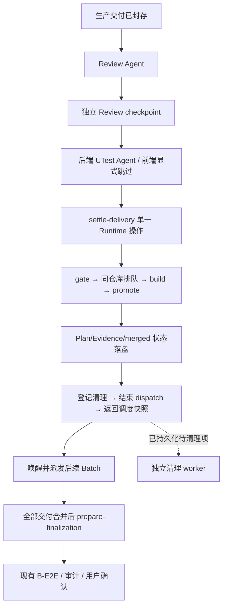

# Review → UTest → Merge 流转提速方案

> 历史方案：其中 UTest/E2E 阶段和测试跳过参数已退出当前 Code Workflow。现行流程见 [Code Batch Workflow Guide](../skills/autodev/autodev-code/references/batch-workflow-guide.md)。

日期：2026-11-01。状态：已实现控制协议 v2，并完成相关回归验证。以下为设计与验收契约；墙钟时间收益仍需真实业务运行对照。

本方案覆盖控制模型调用、候选构建与推广、合并后的清理、调度异常恢复四项。UTest 的首次执行、阶段总时长、单命令时长和修复次数全部沿用现行策略。

## 1. 目标与实施边界

把需要模型判断的 Review、UTest 与固定的状态流转分开。模型继续审查和编写/执行测试；Runtime 连续完成确定性的校验、合并、状态落盘和调度交接。

第一期在本仓库实现，沿用固定 Workflow 的 `agent()`、`parallel()` 和插件 Python 命令，不依赖新增平台原生 command、事件订阅或常驻服务。纯命令步骤仍由一个受限 Agent 调用一个插件入口，不能把 Python 子步骤数的下降宣传为平台模型调用归零。

保留以下业务语义：

- 各 Batch 在独立 Worktree 执行；现有 DAG 依赖、执行阶段、write-set 规则和 `maxParallel` 继续生效。
- Review 独立校验，生产修复和 UTest 修复沿用当前次数与恢复策略；前端 UTest 的显式跳过规则保持原样。
- UTest 失败的分类、Evidence、deferred issue 和后续放行规则保持原样。
- 每个候选仍只包含一个 Batch，仍绑定确切交付提交和集成基准；不能绕过 gate、伪造测试通过或用 rebase 替代候选重建。
- Batch merge 指进入集成分支；全部交付合并后仍执行现有最终 B-E2E、Evidence 审计和用户确认，再按原协议推广到基线分支。
- 后台脚本继续使用工具托管的单次启动和同一 task_id 等待协议。`task_output(timeout:60000)` 是最长等待，不应按每个脚本固定增加一分钟估算。

## 2. 当前开销与目标流程

后端正常路径，从已经封存的生产交付开始，到 Batch merge 和清理完成：

```text
Review Agent
  → Review checkpoint Agent（独立校验并准备 UTest）
  → UTest Agent
  → gate Agent
  → build-candidate Agent
  → promote-candidate Agent
  → cleanup Agent
  → dispatch-finish Agent
  → scheduler status Agent
```

前七步包含 7 次串行模型调用；后两步继续挡在该 worker 的下一次派发之前。当前 `runFinalRepairAndReport()` 在无异常的收尾路径上还会读四次快照。

目标正常路径：



| 统计范围 | 当前 | 改造目标 |
| --- | --- | --- |
| 后端封存后至交付 merge 的正常模型步骤，不含池级轮询 | Review 到清理 7 次，另有 finish/status | Review、checkpoint、UTest、settle 共 4 次 |
| 前端相同范围 | Review 到清理 6 次，另有 finish/status | Review、checkpoint、settle 共 3 次 |
| 无异常的最终修复快照读取 | 4 次模型查询 | 1 次 prepare-finalization |
| 清理 | 每个 Batch 阻塞收尾 | 一个共享 worker 批量处理 |
| 同仓库插件内部并发导致的 stale | 允许发生，随后重建 | 正常场景为 0 |

这些是调用结构和验收目标，不是已取得的耗时收益。冲突解决、生产修复、真实命令失败及外部修改造成的恢复步骤单独统计。

## 3. 新增 settle-delivery：统一受控交接

建议新增 `hooks/parallel_delivery.py`，提供以下入口；具体名称在实现时固定到 Workflow 和命令目录。

```text
parallel_delivery.py settle-delivery
  --workspace <artifact workspace> --feature <feature> --run-id <scheduler run>
  --batch-id <batch> --dispatch-generation <generation>
  --dispatch-token <current dispatch token> --expected-commit <sealed SHA>

parallel_delivery.py prepare-finalization
  --workspace <artifact workspace> --feature <feature> --run-id <scheduler run>
```

`settle-delivery` 通过 Python 内部函数复用现有权威实现，不能把多个 CLI 串成 shell，也不能直接改 Plan 或 Evidence 来替代现有 writer。

正常执行顺序：

1. 校验 run、Batch、当前 dispatch 代次与 token、交付 SHA、运行协议版本。以 `runId + batchId + dispatchGeneration + deliverySha` 定位操作记录；同一输入重试复用原操作，不以 Workflow invocation ID 创建第二次业务合并。
2. 调用现有 gate，机械检查 Review、UTest 状态、Evidence 与封存状态。`deferred/skipped` 保持真实含义。
3. 登记仓库合并队列项，按仓库票号等待准入。等待由同一个托管 Python 任务完成，不反复启动模型或重启命令；等待队列期间不持有 run lock。
4. 获取仓库锁，重新检查代次、交付 SHA、集成 HEAD 和队列所有权，复用或构建该 Batch 候选。
5. 在同一仓库临界区连续完成候选推广及 Git/Plan 恢复协议，确认真实集成 HEAD 与候选 SHA 一致。
6. 将 merged 状态、merge SHA、操作回执、候选与交付 Worktree 的清理意图可靠落盘。不能让“已 merged、没有任何清理记录”成为正常可见状态。
7. 完成当前 dispatch，并返回新的权威 scheduler 工作流视图。Workflow 接受快照后释放本地 worker、立即唤醒等待者。

Git 与 Plan 不组成单个文件系统事务，必须沿用 intent → Git 推进 → Plan recovery → merged 的恢复协议。第 6 步的关联记录在同一 manifest 临界区写入；第 7 步即使中断，也能从操作记录继续，不重新 merge。

返回契约至少包含：

```json
{
  "success": true,
  "status": "merged",
  "runId": "<run>",
  "batchId": "B001",
  "dispatchGeneration": 2,
  "operationId": "<runtime allocated>",
  "deliverySha": "<sealed SHA>",
  "mergeCommitSha": "<promoted candidate SHA>",
  "dispatchFinalized": true,
  "cleanup": { "status": "pending", "jobIds": ["<candidate>", "<delivery>"] },
  "schedulerSnapshot": { "controlRevision": 42, "runId": "<run>" },
  "reused": false
}
```

上例的 `schedulerSnapshot` 为节略示意，实际必须使用完整的现有工作流视图。`merged`、`candidate_conflicted`、`needs_plan_recovery`、`blocked`、`stale_owner_ignored` 分别声明 schema；不能把 success=true 或“命令已启动”单独当作合并成功。

正常成功时不再额外调用 gate、build、promote、cleanup、finish、status Agent。JS 的 finally 仅对没有有效收尾回执的路径执行现有 fenced finish/defer；过期 owner 不能结束新代次的派发。

## 4. 仓库合并队列与锁

**Code、Review、UTest 继续并行；同一物理仓库的候选构建与推广连续执行。不同仓库可以同时合并。**

仓库身份由实际 Git common directory 的规范化路径派生，不能直接用 workspaceRef。多个逻辑 workspaceRef 绑定同一个物理仓库时必须进入同一队列和锁域。建议物理锁路径为 `<gitCommonDir>/autobiz-runtime/repository.lock`，共享 reservation 位于同目录的 `targets/<targetId>.json`；targetId 由物理仓库身份与完整目标分支 ref 派生。这样不同 Workflow invocation、run 或 artifact workspace 也不会误用不同的锁。身份解析兼容 Windows 路径、符号链接和 linked Worktree；没有该 Git 元数据目录的写入能力时明确报错，不退回一个无法跨进程协调的本地锁。

队列状态按 run 保存票号、Batch、generation、delivery SHA、operationId、状态与时间；跨 run 的排他性由物理仓库共享锁保证。run 内按票号准入，避免后到者不断抢先；跨 run 第一版只保证排他，不承诺全局 FIFO。

锁使用规则：

- 保留短的 run lock，只处理 manifest 读改写；不在其中等待仓库锁、跑 Git、等待模型或删除目录。
- 获取仓库锁前释放 run lock；持有仓库锁时可以短暂获取 run lock。所有入口使用同一顺序。
- 仓库锁覆盖重新读取目标 HEAD、构建、推广、Plan 对账和持久化收尾意图；不覆盖实际目录删除。
- 提取无重复加锁的内部函数，由外层入口统一持锁，避免直接嵌套调用当前两个带锁 public 函数。
- build/promote、冲突完成、恢复推广、主分支同步等会修改同一目标的现有入口也遵守该锁域与 reservation 检查，不能从旧 CLI 绕过新协调器。
- 基线最终推广另受现有用户确认与 approvalDigest 约束；本方案的 settle 只能推广到当前 run 已授权的集成目标。

候选 wave 改由 Runtime 在锁内分配，兼容已有最大序号；不再依赖每个 JS invocation 的本地 `++mergeSequence` 分配持久化记录 ID。

第一版保留 `maxParallel` 对整个 Batch 生命周期的限制；排队等待合并仍属于该生命周期。不会通过新增 merge worker 暗中扩大活跃 Batch 数量。本期释放的是合并后清理占用的时间。

### 冲突与外部变动

构建发现真实冲突时，持久化候选、base SHA、授权文件、context digest 和仓库 reservation，再释放 OS 文件锁，返回 `candidate_conflicted`。

Workflow 继续使用现有 prepare-resolution → 模型编辑 → complete-resolution 协议。模型编辑期间不持有 OS 锁；该集成目标的共享 reservation 阻止其他 Batch 推进其 HEAD，其他仓库和独立编码仍可执行。共享 reservation 保存 run/operation/目标/base SHA 与 fencing 身份，在仓库锁内登记；run 内副本只用于展示和恢复索引。任一副本写入中断后先恢复对账，共享 reservation 未核清时禁止推进该目标。

解决完成后重新取得锁，检查 reservation、代次、上下文身份和真实 HEAD，再由同一个 operation 继续推广。失败保留候选与上下文；仅受控解决、取消或恢复操作能解除 reservation，不能靠超时删除记录。

仓库锁只协调插件参与者。人工或外部 Git 修改仍可能造成 stale，继续保留 HEAD 校验和现有有界恢复规则，不宣称完全消除 stale。

## 5. 清理队列移出交付关键路径

候选和交付 Worktree 都必须移出关键路径。目前候选删除发生在 promote 的 Plan recovery 内，只移动 JS 的 cleanup 调用无法完成这项优化。

每个清理项包含：jobId、operationId、run、Batch、generation、仓库身份、候选/交付类型、精确路径与分支、预期 SHA、状态、尝试次数和错误。状态采用 `pending → running → completed`，异常转为 `retryable/needs_inspection`；运行中的 claim 带 fencing 身份，进程中断后可恢复。

清理规则：

1. 只清理已完成 Git/Plan 对账且明确 merged 的交付，或已有等效终态证明的候选。正在冲突解决、Plan recovery、E2E 使用中的目录不入可执行集合。
2. 删除前核对插件 ownership、精确目录、分支、预期 SHA、当前 run/代次、活动 lease 与引用。路径已被新执行复用时停止，不扩大 force 权限。
3. 部分清理后中断可重入：目录不存在但分支还在、分支已删但元数据未完成等情况分别对账，不能重复清理到其他目录。
4. 清理失败只产生清理 issue，不把 merged 改回 failed，不重新打开 Review/UTest，不阻止依赖解锁和基线确认报告生成。
5. 清理不占 Batch 业务执行槽；第一版每个 run 一个受控清理 worker，内部按仓库串行。

第一版默认在全部交付合并后启动清理 worker，与最终验证并行，避免目录删除和活跃交付创建/推广争用 Git 元数据。Workflow 显式使用 `parallel()` 托管这两条链，并等待它们的真实结果；不启动 daemon、脱管进程或会话外自动任务。

清理 worker 设置独立软预算，建议 120 秒，并对单项 Git/子进程提供可恢复的有限执行与终止协议。软预算到达后停止领取新项，在途项按实际终态登记。不能只用 Promise 超时就宣布命令已停止。Windows/Git Bash 的子进程终止与部分删除恢复需要专项验证。

最终报告明确列出 `cleanupPending`。剩余项在同 run 的下一次 launcher/ensure 或显式 cleanup 时继续；如果本次预算耗尽且没有后续执行，状态保持 pending，不承诺后台仍在清理。

## 6. 单一调度刷新与分原因等待

保留完成事件优先的模式，新增 run 级共享刷新协调器。worker 不各自启动轮询 Agent；所有状态刷新共用同一个 in-flight 请求和重试计数。

| 触发原因 | 新策略 | 结果使用 |
| --- | --- | --- |
| settle 成功并返回权威快照 | 立即接受快照、释放本地 worker、广播唤醒 | 正常路径不再追加 status |
| 完成操作未返回快照或发生恢复变更 | 立即发起一次共享 refresh | 成功后再派发 |
| 状态查询为空、传输错误、控制命令不可用 | 第一次立即查询；后续失败按 5、10、20、30 秒退避，封顶 30 秒 | 状态标记 unavailable，不用旧快照派发 |
| claim 因容量/资源竞争被拒绝 | 优先等完成事件；兜底 10–30 秒后共享查询 | 等待不消耗生产修复次数 |
| 没有事件、但仍有潜在工作 | 一个共享 60 秒兜底查询 | 避免长时间漏观察外部恢复变化 |
| 无活动执行、无待处理/恢复工作 | 结束 drain | 不再保留空闲轮询 |

60 秒兜底会比原来的 30 分钟增加稳定等待期间的检查频率，因此必须单独记录池级控制调用数；不能只报告每 Batch 从 7 到 4 就忽略轮询成本。必要时在真实负载验证后调这个调度参数，仍不触碰 UTest 预算。

所有唤醒采用条件重检：等待前、被唤醒后检查当前快照与本地完成序号；信号发生在等待注册前时也不能丢失。generation 过期、共享 refresh 合并、一次广播唤醒多个 worker 都不能重复 claim。

实现中连续 8 次查询失败且已无本地活动执行时结束空转，保留可恢复状态和真实错误；活动任务的独立完成仍可提供新快照恢复调度。该限制不消耗生产修复次数，也不重置 UTest 期限。

Runtime 增加单调 `controlRevision`；所有调度相关的 manifest 写操作在 run lock 内从当前版本推进后原子写入，禁止旧副本覆盖新版本。返回快照绑定 runId、协议版本、revision 和 observedEpochMs，JS 只接受同 run 不回退的版本。revision 变更先全局接入再用于快照复用，不把现有时间戳充当严格版本号。

时钟和请求身份继续由 Runtime 或现有确定性序列提供；不在固定 Workflow 引入 `Date`、`performance`、`Math.random` 等被 sandbox 禁止的全局。

## 7. 最终收尾减少重复快照

`prepare-finalization` 合并一次 scheduler tick、恢复需求检查、交付状态核对和最终化准入。它是有状态的执行入口，不是供 UI 使用的只读接口。

- 若仍有 retry_pending、未落盘失败、冲突、未完成派发或 Plan recovery，返回明确的 repairRequired 和精确项，沿用既有修复流程；不能直接进入 E2E。
- 若全部交付已 merged 且活动派发已关闭，持久化 finalization receipt，再返回一份完整新快照；无异常路径不再额外执行四次 status。
- receipt 绑定交付集合、交付/merge SHA、集成 HEAD、Plan 契约和必要 Evidence 引用。E2E 开始时重新校验这些输入。
- receipt 不因清理进度、遥测写入等无关变化自动失效；交付、契约、证据或集成 HEAD 改变时必须失效并重新准入。
- 复用后的 snapshot 仍需经过当前 schema 与身份校验，不能用模型概括或完整 manifest 的手工汇总代替。

最终 sync-main、B-E2E、Evidence 审计和用户确认沿用现有入口。sync-main 若改变集成 HEAD，仍按既有规则验证新的最终 SHA，不能复用旧 E2E 结果。

## 8. 恢复、幂等与版本兼容

| 中断位置 | 恢复动作 |
| --- | --- |
| gate 前/排队中 | 校验同代次和输入，继续同一队列项 |
| 候选已构建、尚未推广 | 验证候选与目标 HEAD；一致则继续，否则按现有 stale 规则处理 |
| Git 已快进、Plan 未写完 | 仅对账 Plan 和 Evidence，不再次合并、不清理候选 |
| merged 已落盘、清理项未被领取 | 继续 cleanup 队列，不阻断后续 Batch |
| merged 已落盘、dispatch 未结束 | 在当前 fenced 身份下补收尾；已换代时转权威恢复，旧 owner 不得操作新 grant |
| Runtime 已完成、模型返回丢失 | 先恢复同一托管 task_id；任务已终态才用相同操作身份读取/恢复回执 |
| 清理执行了一部分 | 对照 ownership 和真实 Git/目录状态逐项恢复 |
| 状态查询持续失败 | 保留已运行任务及错误，短退避重试；不从旧快照启动新任务 |

增加明确的 `controlProtocolVersion`，并将协调器、清理实现、schema、相关 Runtime 模块加入 runtime contract。所有结构化边界字段显式声明，覆盖 additionalProperties=false 及投影丢字段场景。

发布只修改源模板，通过 launcher 重新校验、计算 digest 并发布；不手改已发布 Workflow 副本。新平台 Workflow invocation 仍可接续同一 scheduler run，不重放已完成的平台 journal 来触发新协议。

旧 run 默认按原协议继续。提供显式的静止态升级入口：确认没有旧活动进程、业务 lease 或 dispatch，先完成既有 Git/Plan recovery，再根据当前持久化事实补充 revision、操作回执和清理项。不得重置阶段、测试期限、Evidence 或生产重试预算。

不对仍有活动旧进程的 run 热迁移，也不假设只新增一个字段就能阻止真正的旧版本进程写入。升级与回退都在静止态完成；回退到旧 Runtime 前须有兼容对账器，否则保留支持新协议的 Runtime 恢复。

## 9. 观测与验收

保留现有 workflowMetrics，补充 Runtime 操作与阶段时间、仓库排队、锁等待、Git 构建/推广、Plan 对账、清理、查询重试、stale 原因和调用分类。operationId、Batch、generation、仓库身份和交付 SHA 用于关联；token 不进入回执或普通遥测。

Python 使用单调时钟记录区间耗时，持久化时间用于展示。模型调用耗时优先使用平台 trace；不可取得时标记未知，不能用脚本耗时冒充模型耗时，也不能为计时额外增加模型调用。

先固定代码版本、同一组任务、模型配置和环境缓存条件，对比正常路径及注入异常的路径。每种核心性能场景至少重复 5 次，报告样本数、中位数和范围；更大样本再统计有意义的尾部指标。

验收至少覆盖：

1. 正常后端每 Batch 4 次、前端 3 次封存后业务链调用；单独统计池级轮询、清理和异常调用，finish/status 不再固定追加。
2. 5 个同仓库、无代码冲突的 Batch 同时就绪，全部恰好合并一次，由插件自身推进产生的 stale 重建为 0。
3. 两个物理仓库可同时合并；同物理仓库的多个逻辑 ref 共用锁；不同 invocation 不重复分配 wave。
4. 对候选和交付删除操作分别注入 60 秒延迟，依赖 Batch 必须在实际清理开始前就可派发；验证第一版直到全部交付合并后才领取清理项，之后与 E2E 并行。业务槽位数保持既有限制。
5. 状态查询首次失败后的下一次重试目标为 5 秒，连续失败退避上限 30 秒，另加真实平台响应时间；多 worker 合计只有一条刷新请求。
6. 在等待注册前/后分别注入完成事件，均能继续派发；迟到旧快照和旧 generation 不覆盖新状态。
7. Git 快进前、快进后、Plan 写入后、dispatch finish 前分别终止进程，再恢复仍只合并一次。
8. 真实冲突保留上下文和 reservation；模型编辑期间未持有 OS 锁，其他仓库继续推进；外部 HEAD 修改仍被识别。
9. 清理失败、部分清理、目录重用、活动 lease 和 Windows 中断场景都不误删、不回退 merged，报告准确 pending。
10. 无异常最终化仅一次控制查询；有异常仍执行必要恢复；测试和 Evidence 质量门、前端跳过规则、最终用户批准保持一致。
11. 所有现有相关回归通过，并补充真实临时 Git Worktree 的并发/故障测试；计数 mock 不能替代恢复正确性验证。

可确定的收益是减少串行控制调用、正常内部 stale 重建和清理等待。墙钟时间改善需要上述基线确认，不预先承诺固定百分比。

## 10. 文件改造与实施顺序

| 文件 | 改动 |
| --- | --- |
| `workflows/code-batched-execution.workflow.js` | 接入 settle、回执/快照、共享刷新和分原因等待；移除成功路径的独立 gate/build/promote/cleanup/finish/status；替换无异常最终化路径 |
| `hooks/parallel_delivery.py`（新增） | settle/finalization 入口、操作幂等、阶段收尾及恢复编排 |
| `hooks/parallel_merge_train.py` | 提取统一锁域的内部构建/推广函数、Runtime wave 分配、reservation；候选清理改登记队列 |
| `hooks/parallel_runtime.py` | controlRevision、操作/队列/清理持久化契约、当前版本校验 |
| `hooks/parallel_dispatch.py` | 复用 finish/defer 的 fencing，支持一次操作内的安全收尾与恢复 |
| `hooks/parallel_batch_scheduler.py` | 权威快照版本、恢复对账、finalization 准入和共享刷新所需字段 |
| `hooks/parallel_cleanup.py`（新增） | 清理 claim、执行、有限预算、部分完成恢复和结果汇总 |
| `hooks/parallel_batch_lifecycle.py` / `hooks/worktree_manager.py` | 复用安全删除，分离清理执行与交付收尾，增加 ownership/引用复核 |
| `hooks/workflow_launcher.py` / `hooks/engineering_contract.py` | 协议配置校验、模板发布、新文件 digest 和静止态升级检查 |
| `hooks/runtime_guidance.py` 与相关 guard | 将新入口纳入命令目录与精确授权；UTest 未收口时仍不能借 settle 绕过 deadline 或闭合协议 |
| Workflow/Runtime/集成测试与批次执行文档 | 同步结构化 schema、调用数、并发、故障恢复与运行指引 |

按以下顺序提交，每一步都能独立验证：

1. **观测与契约**：补充计数分类、耗时和 revision，建立当前版本基线；此时先不复用快照、不改变流转。
2. **连续合并**：实现统一仓库锁域、Runtime wave 与 settle，先用真实 Git 并发/中断测试验证，再接入 Workflow，保留独立 Review checkpoint。
3. **清理解耦**：将候选和交付两类清理都改成可靠队列；验证 merged、cleanup intent 与 dispatch 的中断恢复，再移出关键路径。
4. **调度与最终化**：接入 settle 快照、共享短重试、条件唤醒和单次 prepare-finalization，移除冗余调用。
5. **发布与对照验收**：新 run 启用新协议；旧 run 按原协议完成或在静止态显式升级。对照性能数据和全部质量/恢复检查后切换默认。

建议以同一个版本发布这五步的完整能力，开发时分提交。协议以每个 run 的固定版本选择，不为四个优化点组合大量可切换开关，避免产生难以验证的恢复组合。

## 11. 改造前代码依据（检查基线）

- `workflows/code-batched-execution.workflow.js:1627` 起：Review、独立 checkpoint、UTest 和 gate 的串行调用。
- 同文件 `:1887`、`:1990`：候选构建/推广拆分，以及推广后的同步清理。
- 同文件 `:2495`：finish 后才广播本地完成，再做 scheduler refresh；`:2515` 为查询失败后的等待。
- 同文件 `:20`：30 分钟兜底轮询；`:2903`：最终修复路径中的四次快照读取。
- `hooks/parallel_merge_train.py:217`、`:398`：构建与推广分别持有 integration train lock。
- 同文件 `:545` 起：Git/Plan 对账与同步候选清理，必须一起纳入解耦。
- `hooks/parallel_dispatch.py:104`：现有 finish 的 generation/token/有效期校验。
- `hooks/parallel_batch_scheduler.py:2028`：受控工作流状态投影，新增字段需要显式加入。
- `tests/test_parallel_integration.py:707`：现有同仓库候选过期与重建测试。
- `hooks/workflow_sandbox_contract.py`：固定 Workflow 不能引用环境时钟和随机全局。

实现入口为 `hooks/parallel_delivery.py`、`hooks/parallel_cleanup.py` 和 `hooks/parallel_repository.py`；新建 isolated run 默认启用 v2，旧 run 保留原协议并提供静止态升级入口。`tests/test_parallel_delivery.py` 覆盖真实 Git 并发、冲突 reservation、合并中断、清理恢复与升级；`tests/test_workflow_delivery_control.mjs` 从完整固定 Workflow 验证调用数量与并行清理。实际业务环境的模型延迟、Maven 耗时和 Windows 进程树终止仍须集成验证。

## 12. 本次验证记录

- 相关 Python 回归 123 项通过，覆盖交付/集成/冲突/派发/Runtime schema/launcher/sandbox。最终改动后另跑包含新增真实 Git 场景的 40 项检查通过。
- Workflow JavaScript 回归 88 项通过。完整 v2 Workflow 使用三个 worker 验证后端 4 步、前端 3 步的正常交付链；空闲 worker 不追加冗余状态查询。
- 全量 unittest 运行 1371 项，跳过 1 项；当次发现 2 项断言失败。新增默认版本导致的配置断言已更新并复测通过。另一项 `test_plan_skill_keeps_ui_task_generation_guidance` 是既有 Plan 文档缺少 `UI Task` 字样，相关文件与 HEAD 一致，本次未改动。
- 独立旧脚本 `tests/test_code_workflow_integration.py` 为 9/11 分组通过；其固定文案与旧技能契约断言在当前代码和导出的干净 HEAD 上完全相同。新协议行为由上面的完整 Workflow 与真实 Git 回归验证，不修改这些无关的既有断言来掩盖失败。
- `hooks/utest_policy.py` 没有修改；既有用户未跟踪提案文件未改动。`git diff --check` 通过。
