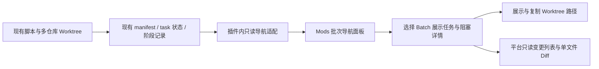

# 自有多仓库 Worktree 的 Mods 批次导航与变更预览方案

本文是方案，尚未实现。平台的具体开发任务以[平台能力清单](/Users/liuxuyang/WebstormProjects/autobiz_kanban/docs/platform-mods-batch-navigation-requirements.md)为准。本方案保留自有执行体系，新增通用只读 Git/文件预览能力，不引入平台 worktree 生命周期接管、Agent 观察协议或执行引擎迁移。

## 1. 最终边界

**脚本负责执行和状态，Mods 负责批次导航，平台提供通用只读变更预览。**

| 事项 | 负责方 |
| --- | --- |
| 多仓库映射、创建和复用 Batch worktree | 现有脚本 |
| 并行调度、依赖解锁、lease、恢复与重试 | 现有脚本 |
| 实现、Review、UTest、Merge Train、最终确认与清理 | 现有脚本 |
| 展示 Batch 的阶段、任务、依赖与阻塞原因 | 新增的批次导航 Mod |
| 选择某个 Batch/worktree、显示分支和路径、复制路径 | 新增的批次导航 Mod |
| 已授权外部目录的变更列表、单文件 Diff 和文件版本预览 | 平台通用只读能力，由 Mod 发起展示 |

不需要把自有 worktree 登记成平台管理的 worktree，不需要使用平台的 acquire/lease/seal，也不需要修改 Workflow 并行执行逻辑。导航中的选择只改变面板选中项。

## 2. 数据流与界面



```text
并行批次     Feature：订单改造    Run：cw-...    [刷新]

全部仓库 / 仓库 A / 仓库 B        执行中 / 阻塞 / 全部

仓库 A
  B001 用户接口  Review       2/3 任务完成
  B002 订单查询  Implement    1/4 任务完成  ← 选中
仓库 B
  B003 管理页面  等待依赖     等待 B002 合入集成分支

B002 · 订单查询
阶段：Implement    状态：执行中
任务：TASK-004 已完成；TASK-005 执行中；TASK-006/007 待执行
阻塞：无已记录阻塞
分支：autodev/feature/run/B002
Worktree：/.../worktrees/.../B002
[复制路径]
[查看变更]  OrderController.java +28 -4  → 点击查看单文件 Diff
最近观察：14:32:06
```

本期展示批次详情、变更文件列表和单文件 Diff，允许读取相关文件的当前/比较版本。不建设代码编辑器、完整仓库文件树或新的 Agent 工具流页面；IDE 打开为可选增强。

“选择 worktree”表示：先选仓库和 Batch，面板展示这个 Batch 当前对应的 worktree。它不会切换主会话目录、Git 分支，也不会为该目录自动创建会话。

## 3. 复用当前 Mods 能力

平台已有示例通过 `$.fs.read` 读取项目状态，再通过 `$.ui.open` 和 Pane 绘制看板，可直接参考 [现有看板示例](/Users/liuxuyang/WebstormProjects/CmbCoworkAgent/examples/autobiz-kanban-mods/hooks/kanban/pane.tsx:135)。

第一期沿用这一方式，建议命令 `/batches`：

1. 读取当前项目范围内指定 Feature/run 的状态文件。
2. 用插件内纯函数整理出 Batch 导航模型。
3. 打开 Pane，提供仓库、Feature/run、状态筛选和批次选择。
4. 点击刷新只重新读取状态文件；点击 Batch 更新面板选择；复制路径使用现有 `ui.copy`。点击“查看变更”调用待新增的平台只读目录/Git 能力，不启动脚本任务。

不依赖 `native.workflow/runs` 的 worktree 列表，也不从平台 Workflow 状态推断自有 Batch 的业务状态。需要固定侧栏入口时，后续可使用已有 Surface 声明，但它不是实现导航的前提。

现有能力可以完成“显示并复制路径”。本次核查未确认一个供 Mod 直接调用的通用“在 IDE 打开目录”接口，因此不把一键打开 IDE 当作现成能力或本期前提。

## 4. 状态如何读取

优先从当前 artifact workspace 下的已知文件读取：

```text
.autobizdevops/features/<feature>/.parallel-runs/<schedulerRunId>/manifest.json
```

配合该 run 的已知阶段记录和 TASK 状态。名称/说明等静态信息按需从 Plan 的明确引用读取；不扫描业务仓库，更不枚举仓库 worktree 来反推 Batch。

当前 manifest 已包含 `taskIds`、`workspaceRef`、`repositoryRef`、`dependencies`、`status`、`activeStage`、`stageStates`、`worktreePath`、`branchName` 和 `error`，依据见 [parallel_runtime.py](/Users/liuxuyang/WebstormProjects/autobiz_kanban/hooks/parallel_runtime.py:385)。TASK 级状态从对应任务已有记录取得，不能把 Batch 阶段当成每个 TASK 的状态。

**不能调用 scheduler 的 `status` 给 UI 刷新。** 它实际会调用 `schedule()` 并处理过期派发、超时和恢复。面板必须直接只读状态文件，依据见 [status 分支](/Users/liuxuyang/WebstormProjects/autobiz_kanban/hooks/parallel_batch_scheduler.py:2152)。

导航适配只返回以下字段：

| 字段 | 用途 |
| --- | --- |
| `feature / schedulerRunId` | 区分 Feature 和脚本运行 |
| `repositoryRef / workspaceRef` | 多仓库筛选，分别保留物理仓库与逻辑工作区归属 |
| `batchId / title` | 批次导航标题 |
| `status / activeStage / stageStates` | 展示批次和各阶段状态 |
| `tasks[]` | 任务 ID、标题、真实状态、记录时间 |
| `dependencies / blockers[]` | 依赖及阻塞详情 |
| `worktreePath / branchName` | 用户定位自己的代码目录 |
| `dispatchGeneration` | 区分重试和重新派发后的批次版本 |
| `sourceUpdatedAt / observedAt` | 区分源状态时间与面板读取时间 |

返回白名单；owner token、dispatch token 等执行凭据不进入 UI 数据。只在 Mod 内保存筛选和选中项，不另建业务状态库。

## 5. 多仓库、工作区范围与大文件

Mod 现有普通文件读取限当前 workspace。多个业务仓库的 worktree 路径可以作为文本显示；查看代码时由平台对授权目录单独提供只读引用，不直接扩大 Mod 的普通 fs 根范围。

推荐在持有 `.autobizdevops` 状态的 artifact workspace 打开导航。若实际会话 workspace 与 artifact workspace 不同，则由插件将一个精简的导航快照导出到当前会话可读目录。不要让 Mod 越界读取，也不要为了导航把多个业务仓库挂载给 Mod。

若 manifest 超过现有文件读取上限、需要合并过多 TASK 记录或清单版本存在兼容差异，同样由插件增加纯读取导出器生成 `batch-navigation.json`。这只是展示缓存，仍以现有运行记录为准；不需要更换原调度器。

使用快照时原子写入，并带来源身份和更新时间；生成失败显示明确的过期/不可用状态，不把导航导出失败当成 Batch 执行失败。没有这些问题时，第一期直接读现有清单即可。

## 6. 阶段和阻塞原因的展示规则

- 阶段取真实 `activeStage` 与 `stageStates`；任务状态缺失时显示“未记录”，不猜测完成。
- 依赖按当前脚本的解锁条件解释。例如依赖要求合入集成分支时，显示“等待 B002 合入集成分支”，不能仅因其 Implement 完成就显示可执行。
- 已有 error、恢复原因、阶段失败原因优先原样保留错误码并提供简短说明。
- 等待并行槽位、依赖、人工确认、失败和恢复分别展示。没有足够事实证明某个原因时，显示“等待调度，具体原因未记录”，不重新运行调度算法替它裁定。
- 尚未创建 worktree 时显示“待创建”；脚本明确记录已清理时显示“已清理”。只从旧路径字段不能证明目录当前仍然存在。
- 默认定位最近活动 run，允许显式选择历史 run；不能把已完成平台 Workflow 与仍在等待确认的 scheduler run 混为一谈。

## 7. 刷新与选择

第一期提供手动刷新，先验证导航闭环。随后增加面板可见期间的定时只读刷新，建议初始间隔 2–3 秒；关闭面板或禁用 Mod 后停止刷新。具体清理实现应按现有 Pane 生命周期接入并验证。

异步响应绑定 `workspace + feature + schedulerRunId` 和本次读取序号，迟到响应不能覆盖用户已经切换的 run。选中项按仓库归属与 Batch ID 保存，重新派发后更新对应 generation 和路径。

读取中的错误、过期记录与未执行是不同状态。面板显示最近一次成功读取时间，刷新失败时明确标记旧数据。

## 8. 最小改动范围

| 文件或位置 | 改动 |
| --- | --- |
| 插件 `mods/parallel-batches.tsx` | 新增命令、Pane、筛选、Batch 选择、任务与阻塞详情、路径复制及变更预览入口 |
| 插件 `mods/parallel-batches-reader.ts` | 只读已有记录，做字段白名单、展示映射和版本兼容 |
| 插件 Mods 作者声明 | 注册新增导航模块及实际需要的读取/UI 权限 |
| 可选 `hooks/export_batch_navigation.py` | 仅在 workspace 不一致、体积或聚合需要时导出展示快照 |

现有 Python 调度、worktree、lease、阶段、合并与确认入口保持原来的执行职责。手动打开普通 Pane 的基础导航可以复用现有 Mods 能力；完整交付需要补齐运行中只读交互、外部目录授权、Git 变更查询和原生变更预览，见第 10 节及平台能力清单。不要求新增 worktree 生命周期管理 API 或 Workflow Agent 参数。

## 9. 验收

1. 两个仓库有多个 Batch 并行运行，可按仓库筛选并切换 Batch，正确显示其阶段、任务、阻塞与自己的 worktree 路径。
2. 同名目录或同一 Batch 的重新派发不会串选；不同 Feature/run 之间的数据互不覆盖。
3. 点击选择、刷新和复制路径，不触发 scheduler、不续 lease、不恢复任务、不写业务状态、不启动模型。
4. 未创建、等待依赖、等待槽位、阶段失败、恢复中、已集成、待最终确认和已清理均有准确展示；缺失事实明确标记。
5. 会话与 artifact 目录分离时通过插件快照展示批次状态；代码读取使用平台对各业务 worktree 的独立授权引用。
6. 刷新失败保留带过期标记的历史视图；关闭面板、禁用 Mod 或切换项目后停止旧读取。

完成标准：Mods 成为现有脚本的批次导航入口，用户能选中自有 worktree 并在平台内查看真实文件变更和单文件 Diff，原有多仓库并行执行继续按自己的脚本运行。

## 10. 平台具体改什么

平台修改集中在通用的 Mods 导航承载、只读交互和外部目录的代码变更预览，不内置 Batch 状态机。以下是源码核查后的实施建议，尚未修改平台代码，也未进行动态验证；接口、优先级和完整验收以独立的平台能力清单为准。

### P0：Workflow 中的常驻导航入口

当前 [ChatContainer.tsx](/Users/liuxuyang/WebstormProjects/CmbCoworkAgent/src/renderer/src/components/chat/ChatContainer.tsx:8930) 仅为普通 Flow 会话挂载 ClawSidebar；Workflow 等其他会话仍挂载 FunctionPanes，但不走这套 Claw 侧栏。平台另有 [PlatformWorkspace.tsx](/Users/liuxuyang/WebstormProjects/CmbCoworkAgent/src/renderer/src/components/platform/PlatformWorkspace.tsx:483) 的通用 sidebar Surface 入口，可以复用。

建议让已启用、已授权的导航 Surface 在 Workflow 会话中有可随时点击的侧栏入口；可在 WorkflowRunPanel 增加“查看扩展导航”的快捷入口。入口通过通用 Surface 身份打开插件，平台不硬编码 AutoBiz 命令或 Batch 数据。

若没有常驻组件实例，应提供显式用户打开时的受控初始化路径。不能仅为列出侧栏而自动执行全部插件命令；也不能为了显示导航，将整套 Claw 执行配置界面放开到 Workflow 模式。

### P0：可与任务并行的只读 UI 动作

[mods-platform.ts](/Users/liuxuyang/WebstormProjects/CmbCoworkAgent/src/main/ipc/mods-platform.ts:184) 当前 Surface act 会走 userAction，再经 [platform-user-action.ts](/Users/liuxuyang/WebstormProjects/CmbCoworkAgent/src/main/mods/v2/platform-user-action.ts:6) 进入 ModCommandQueue。该队列需要获取线程运行 lease；线程已有活动 lease 时会等待，依据见 [command-queue.ts](/Users/liuxuyang/WebstormProjects/CmbCoworkAgent/src/main/mods/command-queue.ts:90)。因此不能保证直接复用这条交互链就能在任务期间随时选择 Batch。

建议新增宿主强制执行的只读视图交互模式，覆盖打开导航、选择、筛选、刷新和关闭。只读回调不获取业务运行 lease，也不排到任务结束后；只允许读取授权文件、更新面板本地选择及重绘。剪贴板复制继续通过已有用户点击入口。任务启动、进程执行、模型调用、业务文件写入和具有副作用的能力动作不能经该模式执行。

这不是把所有 Surface act 改成绕过队列。需要在共享契约、声明校验、IPC 路由和 SDK 调用边界增加只读约束；仅靠插件自报“只读”或前端禁用按钮不足以证明安全。插件更新破坏只读声明时拒绝该交互，而不是转为放行执行。

涉及 `shared/mods/v2/platform-surfaces.ts`、`main/ipc/mods-platform.ts`、`main/mods/v2/platform-surfaces.ts`、`manager.ts`、`session.ts` 及必要的 preload 类型。普通 Pane 的 `mods:function-ui-act` 路径已有独立处理，不能把 Surface 队列结论套到所有 Pane；应保留两条入口的一致只读约束。

### P0：刷新、可见性与选择保持

复用现有 FunctionPanes/PlatformWorkspace 的绘制与生命周期，补齐导航视图的可见/隐藏通知、刷新取消及选中项保持。任务运行本身不禁用导航，面板自己的请求才使用局部 loading。

批次状态仍由 Mod 读取已知文件；状态刷新由平台提供视图生命周期。代码查询使用单独的只读 Git 能力，按当前选中 worktree/文件读取。第一期使用有界轮询即可，不需要平台扫描全部仓库或创建通用文件监听服务。关闭、切换项目、撤销授权后停止旧读取；检查迟到响应不能把已切换的 Batch 覆盖回去。

### P0：外部目录的代码变更预览

平台对已授权的自有 worktree 返回只读目录引用，提供变更列表、单文件 patch、文件版本和原生预览打开能力。支持起点到当前工作目录的累计改动、已提交、暂存、未暂存及未跟踪文件，并明确显示比较基准和读取时间。查询不等待整个 Workflow 结束，不依赖平台管理的 worktree 记录，不触发提交、合并或清理。

详细接口、错误语义、分页和验收见[平台能力清单](/Users/liuxuyang/WebstormProjects/autobiz_kanban/docs/platform-mods-batch-navigation-requirements.md)。

### 可选：在 IDE 打开自己的 Worktree

平台已有 [ide:open 与目录打开能力](/Users/liuxuyang/WebstormProjects/CmbCoworkAgent/src/main/ipc/path-openers.ts:80)，但不是已确认可由 Mod 直接调用的公开方法。需要一键打开时，补一个受当前线程/插件授权和用户点击约束的通用桥接，复用既有 opener；校验目录当前存在且位于授权范围。

该动作只打开精确目录，不切换主会话 cwd、不执行 Git、不接管 worktree。只需要展示/复制路径时，无须这一项。

### 平台验收重点

使用长时间运行且持有线程 lease 的任务验证：打开导航、筛选、切换 Batch 和只读刷新都能完成，且任务继续执行。再用反例证明只读回调不能启动进程、模型、写文件或绕过现有执行队列。验证同项目双会话、切换 run、关闭侧栏、禁用 Mod 和重启后的作用域隔离。
